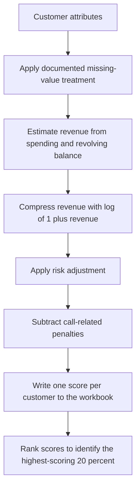

# American Express Campus Challenge - Customer Profitability Ranking

This folder contains my **Round 1 submission for the American Express Campus Challenge 2026, Strategy Track**.

The task was to identify the **most profitable 20% of Premier Card customers** from a population of **500,000 cardmembers**, using 23 anonymized customer attributes. Instead of predicting who spends the most, the approach balances revenue potential with credit risk and call-related signals.

**Reported final result: 0.9144 on the private leaderboard**, evaluated on the hidden 30% of the population. This result is recorded in the accompanying résumé image and confirmed by the submitter. The original leaderboard export is not included in this folder.

The final deliverable is [campus_challenge_r1_FINAL.xlsx](campus_challenge_r1_FINAL.xlsx). Its **Profitability Framework** sheet is the source for the final equation explained below. The decision log documents earlier experiments, including a different formula with a **0.818 public leaderboard score**; that earlier score should not be confused with the final private result.

## The problem in plain language

A customer can generate revenue by spending on the card and carrying a balance that earns interest. However, a high-spending customer may also generate expensive rewards or carry a greater risk of nonpayment.

The question was:

> How can we use the available customer information to rank customers by their likely contribution to issuer profitability?

We needed to produce **one numeric score for every customer**. Higher scores mean higher estimated relative profitability. The highest-scoring 100,000 customers form the predicted top 20% across the full population.

The score is a **ranking signal**, not a forecast of actual profit in dollars and not a probability. A score of 8 does not mean eight dollars of profit or an 80% chance of profitability.

## Why use an explicit formula instead of a trained model?

The supplied features did not include a ground-truth profit label: the organizer held the true outcomes used for evaluation. Without those labels, we could not directly train a supervised model to learn customer profitability.

We therefore used an **explainable scorecard**: a formula whose components have stated business interpretations. The process was to propose a relationship, check whether it behaved sensibly, evaluate available feedback, and revise it.

This choice served three purposes:

- **Work with the available information:** spending, balances, and risk were observable; true profit was not.
- **Explain each decision:** every included feature and weight could be connected to an assumption about revenue, rewards, risk, or retention.
- **Avoid unnecessary complexity:** adding a feature without evidence of useful ranking information could make the equation harder to explain and less reliable.

The coefficients were chosen as economically motivated assumptions and refined through experimentation. They are not published American Express pricing parameters or coefficients learned from labeled customer profits.

## What is in this folder?

| File | What it contains | How to use it |
|---|---|---|
| [campus_challenge_r1_FINAL.xlsx](campus_challenge_r1_FINAL.xlsx) | Final prediction values and the written profitability framework | Start here to inspect the submitted artifact. |
| [amex_r1_decision_log_final.md](amex_r1_decision_log_final.md) | Detailed development history, profiling observations, hypotheses, failed experiments, and earlier results | Read for the reasoning journey; its closing equation differs from the final workbook. |
| [Amex campus challenge resume points.png](Amex%20campus%20challenge%20resume%20points.png) | Short project summary and the reported 0.9144 private leaderboard result | Use as a summary of the submission outcome. |
| `README.md` | Beginner-friendly explanation of the project and its choices | Read before exploring the longer artifacts. |

The original feature dataset, preprocessing code, scoring scripts, and official leaderboard results are **not included**. This folder is a submission archive, not a runnable training repository.

## The data and what we learned from it

According to the decision log, the input contained one row per cardmember, an ID, and 23 features covering spending and balances, benefits and rewards, risk, and engagement.

Several observations affected the approach:

| Observation recorded during development | Why it mattered |
|---|---|
| True profitability labels were unavailable. | We needed a reasoned ranking framework rather than ordinary supervised training. |
| Spending and balances were strongly skewed, with unusually large values for some customers. | Raw amounts could overwhelm other signals, motivating careful treatment of revenue scale. |
| Missing values often appeared in groups, such as several category-spend fields missing together. | A blank value could represent unavailable information; treating every blank as zero would invent low spending or low risk. |
| The field called total spend, `f5`, did not reconcile with the sum of category spending, `f6-f10`. | Adding both indiscriminately would mix inconsistent scales and risk double-counting. The final equation uses category spending. |
| Revolving balance and risk were correlated. | Strong risk penalties could remove the very customers whose balances generated interest revenue. |
| Several engagement fields had sparse or weak signals. | Including every column was not automatically better than selecting a smaller, interpretable set. |

These are observations documented in the log. The raw dataset is absent, so they cannot be recalculated from the workbook alone.

## The final approach

The workbook's equation combines three ideas:

1. Estimate a revenue contribution from category spending and revolving balance.
2. Compress that revenue with a logarithm so extreme amounts have diminishing influence.
3. Adjust for risk, then subtract a small cancellation-call penalty and a larger collection-related-call penalty.



### Features used in the final formula

Although the workbook text says "six variables" in two places, the equation and its feature list use **nine distinct input fields**.

| Feature | Meaning | Why it is included |
|---|---|---|
| `f1` | Average revolving balance over the last 12 months | Represents a balance that can generate interest income. |
| `f6` | Airline spending | Contributes revenue, with a lower assumed margin because it is a 5x reward category. |
| `f7` | Other spending | Part of the general-spend revenue component. |
| `f8` | Entertainment spending | Part of the general-spend revenue component. |
| `f9` | Lodging spending | Treated with airlines as a 5x reward category. |
| `f10` | Dining spending | Part of the general-spend revenue component. |
| `f11` | Riskiness score | Reduces the contribution credited to riskier customers. |
| `f2` | Cancellation-call signal | Adds a small retention-related penalty. |
| `f3` | Collection-related-call signal | Adds a larger penalty for a stronger adverse credit signal. |

The customer ID is used to match predictions to customers. It does not enter the equation.

The wording of `f3` differs between the artifacts: the decision log describes cancellation calls due to collections, while the workbook calls it a collections-call field. The final framework treats it as a stronger adverse signal; a call alone should not be presented as proof of an actual default or realized loss.

### The equation

For each customer, after the documented missing-value treatment:

```text
general_spend = f7 + f8 + f10
travel_spend  = f6 + f9

revenue_base = 0.02  * general_spend
             + 0.006 * travel_spend
             + 0.24  * f1

compressed_revenue = ln(1 + revenue_base)

score = compressed_revenue * (1 - 0.7 * f11)
        - 0.05 * f2
        - 1.0  * f3
```

Here, `ln` means the natural logarithm. This is the equation stated in the final workbook, rewritten in smaller steps for readability.

### Why these components?

| Decision | Reason for taking this approach | What the assumption does not establish |
|---|---|---|
| Use category spending rather than `f5` plus category spending | The fields did not behave like a consistent total-and-parts breakdown. Category fields also allowed different reward-margin assumptions. | The masked feature scales are not proven to be directly comparable accounting amounts. |
| Apply a `0.02` weight to general spending | Represents an assumed 2% revenue/margin contribution for the 1x categories. | It is not a verified issuer-specific interchange rate. |
| Apply a lower `0.006` weight to airlines and lodging | Represents a smaller net contribution after allowing for their higher reward multiplier. | A 5x reward multiplier alone does not mathematically determine an exact 0.6% margin. |
| Apply `0.24` to revolving balance | Represents an assumed 24% annual interest yield, retaining interest-bearing balances as a revenue source. | Actual customer APRs, payment behavior, and collectible interest are not known from this archive. |
| Use `ln(1 + revenue_base)` | Reduces how strongly very large revenue values dominate when revenue is combined with risk and penalties. | It does not turn the score into calibrated profit. |
| Multiply by `1 - 0.7 * f11` | Gives less credit to riskier revenue without using several overlapping risk penalties. | The resulting factor is not a validated probability of repayment. |
| Give `f2` a small penalty and `f3` a larger one | The framework treats cancellation calls as a weaker retention signal and collection-related calls as a stronger adverse signal. | Continued presence in the dataset does not prove retention success, and calls do not prove a financial loss. |

### Why the logarithm matters

The difference between revenue bases of 1,000 and 10,000 is 9,000. After transformation, `ln(1001)` is about 6.91 and `ln(10001)` is about 9.21: a gap of roughly 2.30.

That compression means a large amount contributes less additional score at the upper end. It makes risk and the call penalties more consequential relative to extreme revenue.

A logarithm **alone** preserves the order of revenue values. Its effect on the final customer ranking comes from combining the transformed revenue with the risk factor and penalties.

### A small worked example

Assume a hypothetical customer has:

- General-category spending of 10,000 in total.
- No airline or lodging spending.
- Average revolving balance of 1,000.
- Risk score `0.02`.
- No cancellation or collection-related calls.

Then:

```text
revenue_base = 0.02 * 10000 + 0.006 * 0 + 0.24 * 1000
             = 440

score = ln(441) * (1 - 0.7 * 0.02)
      = approximately 6.004
```

For an otherwise identical customer with risk score `0.20`, the score falls to about **5.237**. If the first customer's collection-related indicator changes from 0 to 1, its score falls by **1.0**.

These examples illustrate the equation. They are invented inputs, not rows taken from the competition data.

## Missing-value treatment

The final workbook documents this preparation before scoring:

| Fields | Replacement for missing values | Reason |
|---|---|---|
| `f1`, `f2`, `f3` | Zero | Assumes no recorded revolving balance or call event. This is a modeling assumption, not a universal interpretation of missing data. |
| `f6-f10` | Each feature's population median | Avoids treating unavailable category spending as confirmed zero spending. |
| `f11` | Population median | Avoids giving an unscored customer the best possible risk value of zero. |

The median is the middle observed value after sorting a feature's nonmissing values.

Earlier versions in the decision log also discuss percentile transforms, missing-value flags, and tail clipping. Those historical choices should not automatically be added to the final formula: the included workbook does not specify all of them as final preprocessing steps.

One reproduction detail remains unresolved: the log records negative values in `f7`, and `ln(1 + revenue_base)` requires `revenue_base > -1`. The workbook does not document a final fallback for an invalid log argument. Its saved predictions are finite, but the missing raw inputs and scripts prevent verifying how every row reached a valid score.

## Why not use all 23 features?

The final equation uses a smaller set of direct revenue and risk signals.

- **Rewards and benefit usage:** travel reward cost is represented indirectly by the lower travel margin. Separate reward/benefit deductions appeared in earlier variants, but the final equation does not include them as additional terms.
- **Total spend (`f5`):** excluded in favor of the category fields because the total and category values did not reconcile.
- **Credit-line fields:** a line represents available borrowing capacity, not necessarily an interest-bearing balance. Earlier exposure-based penalties also risked excessive risk adjustment.
- **Logins, email activity, and card counts:** these may describe engagement, but they are not direct income or cost measurements. The development notes did not establish enough independent ranking benefit to retain them.
- **Annual fee:** the framework assumes an equal fee across customers. Adding the same constant would not alter their ranking.

These are choices for this dataset and submission, not claims that the excluded features never matter in real banking.

## How the approach developed

The decision log preserves both useful findings and corrections to earlier interpretations. A few stages explain the main lessons:

| Development stage | Recorded evidence | Lesson |
|---|---|---|
| Initial percentile-based framework | Public score `0.282`; several risk adjustments largely removed interest-bearing customers from the selected group. | A profitability ranking can accidentally become a lowest-risk ranking. |
| Reduced overlapping risk penalties | Public scores progressed through `0.368`, `0.419`, and `0.448`. | Revenue and risk needed a more balanced treatment. |
| Dollar-scale revenue/cost experiment | Public score `0.539`. | Revenue magnitude and the inclusion of revolving customers carried information that rank-only transformations could hide. |
| Confounded reward-cost experiment | Score `0.271`, but the variant changed both rewards treatment and an exposure penalty. | A bad result cannot be attributed to one feature when two mechanisms changed together. |
| Comparison with a teammate's independent framework | Mechanism comparisons informed a differentiated formula recorded at `0.818` public. | Comparing disagreements helped locate excessive risk adjustment, but agreement with another heuristic was not ground truth. |
| Final workbook in this folder | Log-compressed revenue, category-margin weights, one risk multiplier, and unequal call penalties. Reported private score `0.9144`. | The final artifact emphasizes a compact, explainable balance between revenue and adverse signals. |

**Version boundary:** the decision log closes with a different dollar-scale formula and names `campus_challenge_r1_submission_final.xlsx`, which is not the filename present here. It does not provide a complete transition from its closing formula to the current workbook's log-based equation. The final workbook and the submitter's confirmation determine which submission this README describes.

The workbook says logarithmic compression, category weighting, and softer risk treatment were retained through iterative testing. The archive does not contain separate numerical test results for every final change, so their individual gains cannot be reconstructed here.

## Evaluation and what the result means

The decision log describes the competition objective as **overlap between the true and predicted most-profitable 20%**, with a 70% public and 30% private evaluation split.

Conceptually:

```text
top-20% overlap =
    number of customers in both the predicted and actual top groups
    / number of customers in the actual top group
```

Two random groups that each contain 20% of a population have an expected overlap score of roughly 0.20 under that definition.

The reported **0.9144 private score** should therefore be described as a result on the competition's ranking/selection metric. It is not ordinary classification accuracy over all customers, a profit forecast accuracy, or a measured business return.

Development checks described in the log included:

- **Synthetic profiles:** invented customer scenarios used to check whether the formula behaved as intended.
- **Feature dominance:** checking whether one variable effectively controlled the whole ranking.
- **Stress cases:** checking whether unusually risky, high-revenue customers were being rewarded too strongly.
- **Sensitivity checks:** changing weights or tail treatment and observing how much the selected group changed.
- **Leaderboard feedback:** using organizer-held outcomes to compare submitted candidates.

The numerical results of those checks belong to the formula versions tested in the log. They should not be transferred to the final workbook without rerunning them.

Synthetic checks test consistency with our assumptions, not correctness against real profit labels. Likewise, repeatedly consulting the public leaderboard can influence design choices; the hidden private result is the separately reported final evaluation.

## How to inspect the submission

No Python installation is needed to read the deliverable.

1. Open [campus_challenge_r1_FINAL.xlsx](campus_challenge_r1_FINAL.xlsx) in a spreadsheet application that supports 500,000 rows, such as desktop Excel.
2. Open **Profitability Framework** to read the equation, selected variables, weights, assumptions, and validation narrative.
3. Open **Predictions**. It has an `ID` column and a `Prediction` column, with one numeric score per customer.
4. To explore the top group, work on a copy and sort **both columns together** by Prediction from largest to smallest. The first 100,000 customer rows are the top 20% of the full population.
5. Keep the submission copy in its original row order. Sorting just the Prediction column would attach scores to the wrong IDs.
6. Use the decision log to explore earlier experiments, while keeping the version differences above in mind.

### Checks performed on the included workbook

The file contains:

- **500,000 prediction rows**, excluding the header.
- **500,000 unique IDs**, ordered from `0` through `499999`.
- A finite numeric prediction for every ID.
- Scores ranging from **-1.0** to approximately **9.017585**.
- A full-population top-20% cutoff of approximately **7.464204**, with no tie at that boundary.
- Two sheets: **Predictions** and **Profitability Framework**.

The prediction cells contain **saved values**, not Excel formulas. Changing the written equation in the framework sheet will not recalculate them.

These checks establish the structure and completeness of the saved output. They do not independently establish that every prediction was produced by the written equation or verify the leaderboard score.

## What would be needed to reproduce the scores?

To regenerate this submission, the archive would need:

1. The original customer feature dataset and its authoritative feature definitions.
2. The exact final preprocessing implementation, including median values and any clipping or invalid-input handling.
3. The scoring/export script and its dependency versions.
4. A comparison between regenerated scores and the saved workbook, preserving every ID-to-score match.

For independent verification of the reported outcome, the official evaluation record would also be needed.

The learning value of this submission is the reasoning behind a transparent ranking formula: preserve economically meaningful revenue signals, account for risk without counting it repeatedly, make missing-data assumptions explicit, and use failed experiments to revise the explanation as well as the equation.
